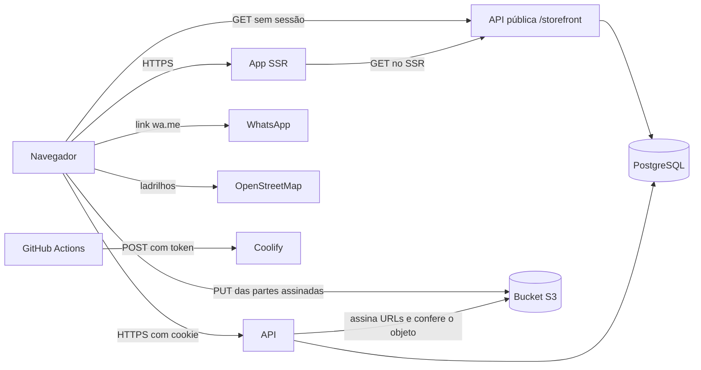

# Segurança

**Aporta** · como avisar de uma falha, o que se protege, de quem, e como

> O modelo de ameaças (§2) é ancorado em evidência: cada fronteira, superfície e abuso aponta um
> caminho do repositório. Revisado quando muda fronteira: rota pública nova, integração, upload,
> papel novo (`_standards/documentation.md` §5). Segredo encontrado no caminho é redigido aqui,
> nunca copiado.
>
> Estado em 2026-11-02: o backend lê anúncios, bairros e guia em rotas públicas (`/storefront`),
> só `GET`, e o frontend as chama, no servidor (SSR) e direto do navegador; ainda não há escrita de anúncio. Onde uma proteção só existe como plano, a linha diz
> "Planejado" e não conta como mitigação pronta.

## 1. Como reportar uma vulnerabilidade

Não abra issue pública. Use o relato privado de vulnerabilidade do GitHub no repositório
`jhollyfer/aporta` (aba Security), se estiver habilitado, com passos para reproduzir. O e-mail de
segurança e o prazo de resposta ainda não foram definidos pelo dono do produto: ficam como pergunta
aberta em `PRD.md` §8 e em `MEMORY.md`.

## 2. Modelo de ameaças

### 2.1 Escopo e premissas

- Dentro: o app público (`frontend/`, SSR em Nitro), a API (`backend/`), o bucket de arquivos, o
  pipeline de deploy (`.github/workflows/`) e o que o visitante envia (URL, formulário, arquivo).
- Fora: o aplicativo e o servidor do WhatsApp, os ladrilhos do OpenStreetMap, o painel do Coolify e
  o provedor do bucket (analisados só pela fronteira com o Aporta).
- Premissas: TLS terminado no proxy (Traefik do Coolify); banco sem acesso público; bucket
  privado. Runtime de produção se separa de CI e de desenvolvimento: o CI usa `APP_KEY` de
  mentira e a senha do administrador de teste nasce por execução.

### 2.2 Componentes, fluxos e fronteiras de confiança

| Fronteira | Entre | O que a protege | Evidência |
|---|---|---|---|
| internet para a API | navegador e API | cookie `httpOnly`, lista de origens (CORS, `CORS_ORIGINS`, que o frontend em produção passa a exigir para ler `/storefront` do navegador), barreira de `Origin` nas escritas, limite de tentativas | `backend/config/session-token.ts`, `backend/config/cors.ts`, `backend/app/middleware/origin.middleware.ts`, `backend/start/limiter.ts` |
| navegador para o bucket | navegador e S3 | URL de parte assinada (1 hora), `Content-Type` fixado na assinatura, bucket privado, CORS restrito à origem do app | `backend/app/services/multipart/multipart.service.ts`, `backend/infra/r2-cors.json` |
| visitante para o app | navegador e SSR | busca validada por Zod com `.catch`, sem segredo no bundle (só `VITE_*`), sem HTML de usuário | `frontend/src/routes/_public/listings/-search.ts`, `frontend/src/env.ts` |
| equipe para a documentação da API | navegador e `/openapi.json`, `/documentation` | só a equipe vê; os demais recebem 404 | `backend/app/middleware/documentation.middleware.ts` |
| visitante para a API pública | navegador e `/storefront` | só `GET`; sem sessão por desenho; o repository corta a linha (`PUBLISHED` fora da lixeira), o presenter corta a coluna; `perPage` até 100 e `search` até 100 caracteres; o app chama sem cookie e sem credencial (`frontend/src/integrations/tanstack-query/http.ts`) | `backend/start/routes.ts`, `backend/app/features/storefront/storefront.e2e.spec.ts`, `backend/app/features/storefront/*/*.presenter.ts` |
| papel para o grupo `/storages` | sessão e arquivos | sessão e papel `ADMINISTRATOR` ou `MODERATOR` | `backend/start/routes.ts` |
| CI para o Coolify | GitHub Actions e a instância | `COOLIFY_TOKEN` como segredo, UUIDs e URL em `vars` do repositório | `.github/workflows/main-deploy-coolify.yml` |

### 2.3 Ativos

| Ativo | Por quê importa | C / I / D | Onde fica | Quem acessa |
|---|---|---|---|---|
| Conta e senha da equipe | tomada de conta de moderação deixa publicar ou arquivar anúncio | C, I | senha em hash scrypt na tabela `users` | ninguém lê a senha |
| Sessão (cookie) | quem a tem age como a conta | C | cookie `httpOnly` e hash na tabela `auth_access_tokens` | o próprio navegador |
| WhatsApp, nome e e-mail do dono | dado pessoal (LGPD); número exposto atrai spam e golpe | C | `listings.owner_name` e `listings.owner_whatsapp` (dono denormalizado); o `localStorage` do dono no rascunho; hoje a tabela só tem os dados de exemplo (telefones fictícios) | qualquer visitante vê nome e WhatsApp do anúncio publicado, por design; o e-mail do dono não existe nesta tabela |
| Anúncio e selo "dono verificado" | a confiança do produto: selo falso ou anúncio falso é golpe | I | tabela `listings`, coluna `owner_verified_at` | a resposta pública só diz se o dono é verificado, nunca quando; dono edita o próprio e equipe modera quando a escrita existir |
| Fotos dos imóveis | privacidade da casa e prova de que o imóvel existe | C, I | bucket privado, leitura por URL assinada | dono do anúncio, equipe |
| Segredos de deploy | publicar versão adulterada | C, I | segredos e `vars` do repositório; variáveis do painel do Coolify | quem tem acesso ao repositório e ao painel |
| Disponibilidade do site | a decisão de moradia é sazonal (chegada dos calouros, festival) | D | Coolify | todos |

C = confidencialidade, I = integridade, D = disponibilidade.

### 2.4 Atacante

| Pode | Não pode (premissa) |
|---|---|
| chamar qualquer rota pública e mexer na URL de busca | ler o banco ou o bucket diretamente |
| criar conta de dono, quando o cadastro existir, e publicar anúncio falso | interceptar TLS |
| trocar ids na URL e no corpo | forjar o cabeçalho `Origin` de um navegador, nem `Sec-Fetch-Site` |
| paginar a listagem pública inteira e coletar todos os WhatsApps publicados, sem sessão | assumir o painel do Coolify ou o GitHub |
| usar computador compartilhado (lan house) depois do dono | escrever no `localStorage` de outro usuário |
| mandar arquivo disfarçado de imagem | enganar a conferência da assinatura do arquivo no servidor |

### 2.5 Superfícies

| Superfície | Como chega | Fronteira | Evidência |
|---|---|---|---|
| entrada da conta | `POST /authentication/sign-in` | internet para a API | `backend/app/features/authentication/session/sign-in/` |
| renovação e saída | `POST /authentication/refresh`, `POST /authentication/sign-out` | internet para a API | `backend/start/routes.ts` |
| perfil | `GET` e `PUT /account` | internet para a API | `backend/app/features/account/profile/` |
| upload e biblioteca | `/storages` e URL assinada de cada parte | navegador para o bucket | `backend/app/features/storage/files/`, `backend/app/services/multipart/` |
| documentação da API | `/openapi.json`, `/documentation` | equipe | `backend/app/middleware/documentation.middleware.ts` |
| listagem pública de anúncios | `GET /storefront/listings` com `page`, `perPage`, `search`, `type`, `neighborhood`, `period`, `minPrice`, `maxPrice`, `sort`, `direction` | visitante para a API pública | `backend/app/features/storefront/listings/paginate/`, `backend/app/validators/storefront/listings.validator.ts` |
| anúncio pelo `slug` | `GET /storefront/listings/:slug` | visitante para a API pública | `backend/app/features/storefront/listings/show/` |
| bairros | `GET /storefront/neighborhoods` | visitante para a API pública | `backend/app/features/storefront/neighborhoods/paginate/` |
| guia | `GET /storefront/places` com `category` | visitante para a API pública | `backend/app/features/storefront/places/paginate/` |
| busca pública | `/listings` com parâmetros na URL | visitante para o app | `frontend/src/routes/_public/listings/-search.ts` |
| detalhe do anúncio | `/listings/$slug` | visitante para o app | `frontend/src/routes/_public/listings/$slug.tsx` |
| guia | `/guide?category=` | visitante para o app | `frontend/src/routes/_public/guide/-search.ts` |
| cadastro do dono | `/list-your-place` e `localStorage` | navegador | `frontend/src/routes/_public/list-your-place/`, `frontend/src/hooks/use-draft-storage.ts` |
| pin do mapa | HTML do `divIcon` do Leaflet | navegador | `frontend/src/components/common/listing-map/listing-map-canvas.tsx` |
| link de WhatsApp | `wa.me` com o número e a mensagem | navegador para o WhatsApp | `frontend/src/lib/whatsapp.ts` |
| sitemap e robots | `/sitemap.xml` (busca a lista de anúncios na API, no servidor) e `/robots.txt` | internet para o app | `frontend/src/lib/sitemap.ts`, `frontend/src/routes/sitemap[.]xml.ts` |
| healthcheck | `GET /health-check` nos dois apps | internet | `backend/app/features/health-check.controller.ts`, `frontend/src/routes/health-check.ts` |

### 2.6 Abusos priorizados

| Id | Abuso | Probabilidade | Impacto | Prioridade | Mitigação | Evidência |
|---|---|---|---|---|---|---|
| TM-001 | Golpe de anúncio: conta de dono publica imóvel que não existe, com foto roubada, para cobrar sinal | alta | alto | alta | Planejado: moderação antes ou depois de publicar, selo "dono verificado", "atualizado há X dias" e canal de denúncia; moderação antes de publicar, selo na conta do dono, denúncia pública com limite por IP e fila da equipe; falta provar o filtro de foto roubada, que a moderação faz à mão | E2E de navegador `moderation.spec.ts` e E2E do backend de `administrator/*`; tela do selo em `frontend/src/components/common/owner-card/owner-card.tsx` |
| TM-002 | Dono lê, altera ou apaga arquivo ou anúncio de outro dono trocando o id | média | alto | alta | `/storages` fechado a `ADMINISTRATOR` e `MODERATOR` até haver policy de posse; anúncio do dono precisa nascer com escopo pela sessão e 404 igual ao inexistente | `backend/start/routes.ts`, `backend/app/middleware/role.middleware.e2e.spec.ts`, `backend/app/policies/storage.policy.unit.spec.ts` |
| TM-003 | Abrir `/storages` ao papel `OWNER` sem policy de posse | média | alto | alta | Regra em `RULES.md` §2: a mudança pede pergunta; a tarefa de fotos precisa entregar a policy antes | `backend/start/routes.ts` |
| TM-004 | Força bruta contra conta da equipe | média | alto | alta | 5 tentativas por minuto por IP e 20 por hora por conta, com bloqueio de 10 minutos; o mesmo orçamento vale para a troca de senha | `backend/start/limiter.ts`, `backend/app/features/authentication/session/sign-in/sign-in.e2e.spec.ts` |
| TM-005 | Escrita forjada por outro site, com o cookie da vítima | média | alto | alta | barreira de `Origin` em todo método que não seja `GET`, `HEAD` ou `OPTIONS`, lista de origens e `Sec-Fetch-Site`; cookie `sameSite` conforme a topologia | `backend/app/middleware/origin.middleware.ts`, `backend/app/middleware/origin.middleware.e2e.spec.ts` |
| TM-006 | Upload malicioso: SVG ou HTML servido do bucket, tipo falso, arquivo enorme | média | alto | alta | lista fechada de tipos sem SVG, tipo e extensão pelo `mimetype` declarado, conferência de assinatura e tamanho no `complete`, teto `UPLOAD_MAX_SIZE`, limite de 60 requisições por hora por usuário | `shared/src/enums/storage-mimetype.ts`, `backend/app/domain/shared/file-signature.value-object.unit.spec.ts`, `backend/app/domain/storage/storage.unit.spec.ts`, `backend/app/features/storage/files/complete/complete.e2e.spec.ts` |
| TM-007 | Injeção de HTML no pin do mapa por texto do dono | média | médio | média | o HTML do pin leva só o preço formatado, nunca texto do dono | `frontend/src/components/common/listing-map/listing-map-canvas.tsx`; sem teste automatizado (lacuna em `TEST-PLAN.md`) |
| TM-008 | Número de WhatsApp malformado ou com texto no link | média | médio | média | o link remove tudo que não é dígito e codifica a mensagem; o formulário só aceita dígitos. O validator de `shared/` só confere o tamanho (10 a 13), sem exigir dígitos: a API precisa recusar caractere não numérico | `frontend/src/lib/whatsapp.ts`, `frontend/src/lib/whatsapp.test.ts`, `shared/src/validators/owner/listings.validator.ts` |
| TM-009 | Coleta em massa dos WhatsApps publicados para spam ou golpe | alta | médio | média | Aceito por desenho (o número é público para o contato direto). A API pública já devolve `owner.whatsapp` na listagem e no detalhe, até 100 anúncios por página, sem sessão e sem limite por IP, e a listagem do app pede justamente 100 por vez para o mapa, então uma única chamada colhe todos os números do catálogo atual. Planejado: avaliar limite por IP e não listar o número na resposta de listagem | `backend/app/features/storefront/listings/listings.presenter.ts`, `backend/app/features/storefront/listings/paginate/paginate.e2e.spec.ts`; sem teste que prove um limite, porque não há |
| TM-010 | Rascunho do cadastro (nome e WhatsApp) lido por quem usa o mesmo computador depois | média | médio | média | chave versionada e mantido só no navegador; o cadastro ainda não envia nada e não apaga o rascunho ao concluir, então ele fica no aparelho até o dono limpar os dados do site; o apagamento no envio volta quando o envio existir | `frontend/src/hooks/use-draft-storage.ts`; sem aviso ao dono sobre computador compartilhado (lacuna) |
| TM-011 | Filtro de URL malformado derruba a página ou injeta valor | alta | baixo | baixa | cada campo da busca tem `.catch(undefined)` e o bairro é conferido contra a lista real; o React escapa o texto | `frontend/src/routes/_public/listings/-search.ts`, `frontend/src/routes/_public/listings/-search.test.ts` |
| TM-012 | Segredo ou credencial no repositório ou no CI | média | alto | alta | varredura de segredo em todas as refs, `pnpm audit` em produção, seeder sem senha padrão e só fora de produção, workflows sem `pull_request_target` | `.github/workflows/ci.yml`, `.gitleaks.toml`, `backend/database/seeders/user.seed.ts` |
| TM-013 | Anúncio velho ou já alugado exposto como disponível (engenharia social e perda de confiança) | alta | médio | média | Planejado: política de prazo sem atualização; hoje a tela mostra "atualizado há X dias" | `frontend/src/components/common/owner-card/owner-card.tsx`; política em aberto em `PRD.md` §8 |
| TM-014 | Colisão de cookie com outro projeto da casa: com `COOKIE_DOMAIN=.maiyu.com.br` e os mesmos nomes `access-token` e `refresh-token`, o login em um projeto sobrescreve a sessão do outro, e um projeto recebe o cookie do outro | média | médio | média | Mitigado: os cookies levam o prefixo `aporta-`. Resta conferir em produção que `COOKIE_DOMAIN=.maiyu.com.br` não choca com outro projeto | `backend/config/session-token.ts`; spec de cookie do `sign-in` |
| TM-015 | Enumeração por `slug`: o visitante tenta endereços de anúncio para achar rascunho, anúncio em análise ou arquivado | média | baixo | baixa | Rascunho, em análise, arquivado, na lixeira e inexistente respondem o mesmo `404` `LISTING_NOT_FOUND`, então a resposta não confirma que o anúncio existe; o escopo `published` do model corta a linha na consulta. O `slug` de anúncio publicado é público por desenho, e a resposta traz `id` em UUID, nunca sequencial | `backend/app/features/storefront/listings/show/show.e2e.spec.ts` ("answers the same 404"), `backend/app/repositories/listing/listing.repository.e2e.spec.ts`, `backend/app/models/listing.ts` |
| TM-016 | Raspagem ou carga na leitura pública: muitas chamadas a `/storefront`, inclusive com `search` | média | médio | média | Mitigado em parte: leitura da vitrine limitada a 120 por minuto por IP (`storefrontReadThrottle`), 429 com `Retry-After`, `Cache-Control: public, max-age=60, stale-while-revalidate=300` (abaixo dos 15 minutos da URL assinada de foto), `perPage` até 100 e `search` até 100 caracteres. O SSR repassa o `X-Forwarded-For` do visitante, e o limite só vale por visitante se `TRUSTED_PROXIES` cobrir a rede do Nitro. A busca é `ILIKE` sem índice próprio | `backend/start/limiter.ts`, `backend/app/middleware/public-cache.middleware.ts`, `frontend/src/integrations/tanstack-query/http.server.ts`; sem teste de carga 

### 2.7 Calibragem de criticidade

- Crítico: uma conta da equipe tomada, ou arquivo ou anúncio de um dono alterado por outro, ou selo
  de verificação concedido por falha (o produto promete confiança).
- Alto: golpe que passa pela moderação, upload que expõe HTML do bucket, segredo no repositório.
- Médio: número de WhatsApp coletado em massa, dado pessoal no rascunho local.
- Baixo: enumeração de recurso público (TM-015), filtro de URL inválido.

### 2.8 Para revisão manual

- O frontend não define cabeçalhos de segurança (CSP, `X-Frame-Options`, `Referrer-Policy`) no
  Nitro. A API tem CSP restritiva e HSTS (`backend/config/shield.ts`). O app público pede revisão
  antes do lançamento, principalmente depois que o mapa carregar ladrilhos e a galeria carregar
  fotos de outro domínio.
- A lista de tipos de arquivo herdou PDF e quatro tipos de áudio da fundação. Foto de anúncio só
  precisa de imagem: restringir ao entregar o upload de fotos.
- O teto `UPLOAD_MAX_SIZE` é global (1 GiB no exemplo): foto de anúncio precisa de teto próprio.
- A origem de `backend/infra/r2-cors.json` já é a do app (`https://aporta.maiyu.com.br`); falta aplicar
  o arquivo no provedor do bucket e conferir o `ETag` exposto.
- Conferir `CORS_ORIGINS=https://aporta.maiyu.com.br` na API de produção: o navegador chama `/storefront` direto, e a lista não pode virar `*` nem ficar vazia (`ENV.md`).
- Conferir em produção que o cookie `aporta-*` não colide com outros projetos do domínio `maiyu.com.br` (TM-014, mitigado pelo prefixo).
- Revisar cada rota de anúncio nova quanto a escopo por sessão, 404 igual ao inexistente e ao dado
  que a listagem pública devolve do dono.
- O que a API pública devolve do dono: `name`, `whatsapp`, `verified` e a data de atualização do
  anúncio. Nunca devolve `status`, `deletedAt`, `neighborhoodId`, o instante de verificação
  (`owner_verified_at`) nem o `id` de usuário (não há `owner_id` ainda). Cada presenter lista os
  campos permitidos e o E2E do detalhe compara a lista inteira de chaves, então uma coluna nova
  não vaza sozinha. Bairro sai sem `id` e sem datas; lugar sai sem `neighborhoodId`, `deletedAt` e carimbos de criação e atualização.
- Quando uma rota de escrita entrar em `/storefront`, ela leva limite próprio na rota
  (`backend/start/routes.ts`) e o teste de "só `GET`" em `storefront.e2e.spec.ts` precisa mudar de
  propósito.

## 3. Autenticação e sessão

- Sessão por par de cookies `httpOnly` (acesso e renovação), com `path` `/`, `secure` em produção e
  `sameSite` calculado entre a origem do app e a URL da API (`lax` ou `none`). O domínio vem de
  `COOKIE_DOMAIN`. Não há fallback para o cabeçalho `Authorization`: o cookie `httpOnly` é o único
  caminho. Evidência: `backend/config/session-token.ts`, `backend/app/guards/cookie-access-tokens.guard.ts`.
- Expiração: acesso de 1 dia e renovação de 7 dias.
- Trocar e-mail, senha ou papel, desativar ou arquivar a conta derruba as sessões abertas
  (`backend/app/domain/user/user.entity.ts`).
- Limite de tentativas no login (por IP e por conta), no `refresh` (60 por minuto por IP) e na troca
  de senha, que gasta o mesmo orçamento do login (`backend/start/limiter.ts`).
- Login responde `401` com a mesma mensagem (`INVALID_CREDENTIALS`) para senha errada e para conta
  inexistente. Recuperação de senha e convite não existem ainda.
- Hash de senha: scrypt (`backend/config/hash.ts`).
- O dono se cadastra por `POST /authentication/sign-up`: o papel `OWNER` é do caso de uso, nunca do
  cliente (uma chave `role` no corpo é descartada), a senha segue a política do `sign-in`, o limite é
  de 5 por minuto por IP com bloqueio de 10 minutos (`signUpThrottle`) e o cadastro não abre sessão:
  a pessoa entra em seguida. Não há confirmação de e-mail por enquanto: nenhum anúncio publica sem
  moderação. E-mail já usado responde `409`, o que permite descobrir se um e-mail tem conta; o
  limite por IP é o freio e fica como risco aceito até haver provedor de e-mail.
- Cabeçalhos: a API envia CSP `default-src 'none'`, `X-Frame-Options`, HSTS de 180 dias, `nosniff` e `Referrer-Policy: no-referrer`. O app envia CSP por resposta com nonce (`script-src 'self' 'nonce-…'`, sem `unsafe-inline`; `style-src-attr 'unsafe-inline'` porque o SSR escreve `style=""` nas cenas SVG), `frame-ancestors 'none'`, `nosniff`, `Referrer-Policy`, `Permissions-Policy` e HSTS de um ano sem `includeSubDomains`. `STORAGE_PUBLIC_URL` libera o bucket em `img-src` e `connect-src`; sem ela as fotos reais são bloqueadas.
- Papéis da equipe: tudo em `/administrator` exige `ADMINISTRATOR` ou `MODERATOR`; o dono recebe 403. A equipe vê o e-mail da conta do dono. Verificar só vale para conta `OWNER` viva.
- Denúncia pública: `POST /storefront/reports` com limite de 5 por hora por IP, campo isca `website` que responde 201 sem gravar e 404 igual para anúncio que não está no ar.
- Anúncio do dono: a posse é regra de domínio e de policy (`listing.policy.ts`); anúncio de outro dono e anúncio sem dono respondem o mesmo 404 do inexistente. O anúncio nasce em análise e `update` nunca muda `status`, `slug` nem dono. Trocar nome ou WhatsApp do contato limpa a verificação. Escrita limitada a 60 por hora por conta (`listingWriteThrottle`).
- `/storages` está aberto ao `OWNER` com policy por dono do arquivo: arquivo alheio responde 404, a coleção inteira só a equipe lê, e arquivo ligado a uma foto não se apaga (409). Foto aceita só imagem. Falta provar o upload ponta a ponta com bucket real.
- Os cookies de sessão levam o prefixo do projeto (`aporta-access-token` e `aporta-refresh-token`).
- O navegador só lê `Retry-After` de outra origem porque o CORS o expõe (`backend/config/cors.ts`);
  é dele que a tela tira o tempo de espera do `429`.
- No app, a rota privada abre só no cliente (`ssr: false` em `_private`) e a dica de sessão no
  `localStorage` apenas evita o piscar da tela: quem decide é sempre a API.
- A primeira conta de administrador nasce do seeder só se `SEED_OWNER_PASSWORD` tiver valor, e o seeder
  para se faltar `SEED_OWNER_EMAIL`. As contas de demonstração (`moderator@example.com`,
  `owner@example.com`) só existem onde `SEED_DEMO_PASSWORD` foi definida: em produção ela fica
  ausente, e nunca se reaproveita a senha do administrador.

## 4. Autorização

- Toda rota autenticada passa por policy (`_standards/backend.md` §4.6); escopo pela sessão
  (`actor`), nunca por id vindo do cliente.
- Recurso de outro dono responde 404, igual ao inexistente. A política de download de arquivo já
  responde assim (`backend/app/policies/storage.policy.ts`).
- Perfis (`ARCHITECTURE.md` §8):

| Perfil | Pode hoje | Não pode |
|---|---|---|
| visitante | ver busca, detalhe, guia, e abrir o WhatsApp; ler `/storefront` sem sessão | qualquer rota autenticada |
| `OWNER` | ver e editar a própria conta | `/storages` e a documentação da API |
| `MODERATOR` | `/storages`, documentação da API, a própria conta | apagar de vez, gerir contas (regra do papel; ainda sem rotas) |
| `ADMINISTRATOR` | tudo o que a equipe faz e apagar de vez | |

- `/storages` fica fechado à equipe até existir policy de posse por dono (`DECISIONS.md` #2).

## 5. Entrada e saída

- Todo dado de fora passa pelo validator antes de chegar à regra: VineJS na API, com paridade com o
  Zod de `shared/` conferida por `validators:check`; Zod no frontend e na URL.
- Upload: lista fechada de tipos (`shared/src/enums/storage-mimetype.ts`, sem SVG), tamanho fixado na
  assinatura e conferido no `complete`, conferência da assinatura do arquivo, partes de 10 MiB com
  URL de parte assinada de 1 hora de vida, URL de leitura de 15 minutos e URL de download com nome
  original de 5 minutos. Sem varredura de vírus.
- Campo de texto do anúncio tem teto de tamanho (título 80, descrição 600, regras 600, endereço 120).
- Resposta de erro não vaza stack, SQL ou caminho interno (`backend/app/exceptions/handler.e2e.spec.ts`).
- O frontend não renderiza HTML vindo de usuário; o único HTML montado à mão é o do pin do mapa, com
  o preço formatado.

## 6. Segredos

- Só em variável de ambiente (`ENV.md`); nada de segredo no código, log ou `docs/`.
- Segredos do repositório: `DOCKERHUB_USERNAME`, `DOCKERHUB_TOKEN`, `COOLIFY_TOKEN`.
- Rotação: Não definida ainda. `APP_KEY`, credenciais do bucket, do banco e do Coolify não têm
  procedimento escrito de troca, e a troca de `APP_KEY` precisa prever a leitura da chave anterior
  durante a transição. Pendência em `TASKS.md`.

## 7. Dependências

- Versão mais nova publicada (`_standards/tooling.md` §0); CVE corrigido assim que sai.
- `pnpm audit --prod --audit-level=high` e varredura de segredo (gitleaks, em todas as refs) no
  workflow `CI` de pull request; Dependabot semanal para npm, GitHub Actions e Docker
  (`.github/dependabot.yml`). O CI ainda nunca rodou no GitHub.

## 8. Dados pessoais (LGPD)

| Dado | Finalidade | Base legal | Retenção | Exclusão |
|---|---|---|---|---|
| Nome e e-mail da conta | entrar e identificar quem opera ou anuncia | execução de contrato (a confirmar com o dono) | enquanto a conta existir | arquivamento lógico hoje; anonimização em prazo ainda não definida |
| Nome e WhatsApp do dono no anúncio | o visitante falar com o dono | execução de contrato e consentimento do dono ao publicar (a confirmar com o dono) | enquanto o anúncio estiver publicado; as colunas `owner_name` e `owner_whatsapp` ficam em `listings` mesmo arquivado, e a API pública não devolve anúncio arquivado | definir com a política de anúncio parado (`PRD.md` §8) |
| Rascunho do cadastro | não perder o que foi digitado | consentimento implícito do uso do formulário | no navegador do dono, até o dono limpar os dados do site; é apagado quando o envio cria o anúncio | apagado no envio com sucesso; o dono pode limpar os dados do site antes |
| Denúncia de golpe | a equipe apurar o anúncio | legítimo interesse na segurança da plataforma (a confirmar com o dono) | o motivo e o texto livre (até 500 caracteres, podem citar terceiros) ficam sem prazo definido; do IP guarda-se só um HMAC com a `APP_KEY`, pseudonimização que deixa de casar se a chave mudar | prazo e anonimização a definir; a equipe só vê os 12 primeiros caracteres do hash |
| Motivo de recusa e nota de resolução | explicar a decisão ao dono e registrar quem decidiu | execução de contrato | enquanto o anúncio ou a denúncia existir | acompanha o registro |
| Foto do imóvel | mostrar o imóvel | execução de contrato | enquanto o anúncio existir | apagar o objeto do bucket junto com o anúncio (a implementar) |

A base legal e os prazos são proposta técnica, não parecer jurídico: o dono do produto confirma
antes do lançamento.

## 9. Checklist de revisão

- [ ] Rota nova tem auth e policy; rota pública nova, integração, upload ou papel atualizou o §2.
- [ ] Nenhum segredo no diff.
- [ ] Entrada validada; saída sem dado de outro usuário e sem WhatsApp além do que o anúncio publica.
- [ ] Log sem senha, token, documento ou outro dado pessoal.
- [ ] Texto do dono nunca vai para HTML montado à mão.
- [ ] Anúncio, foto e arquivo de um dono não aparecem para outro dono.
